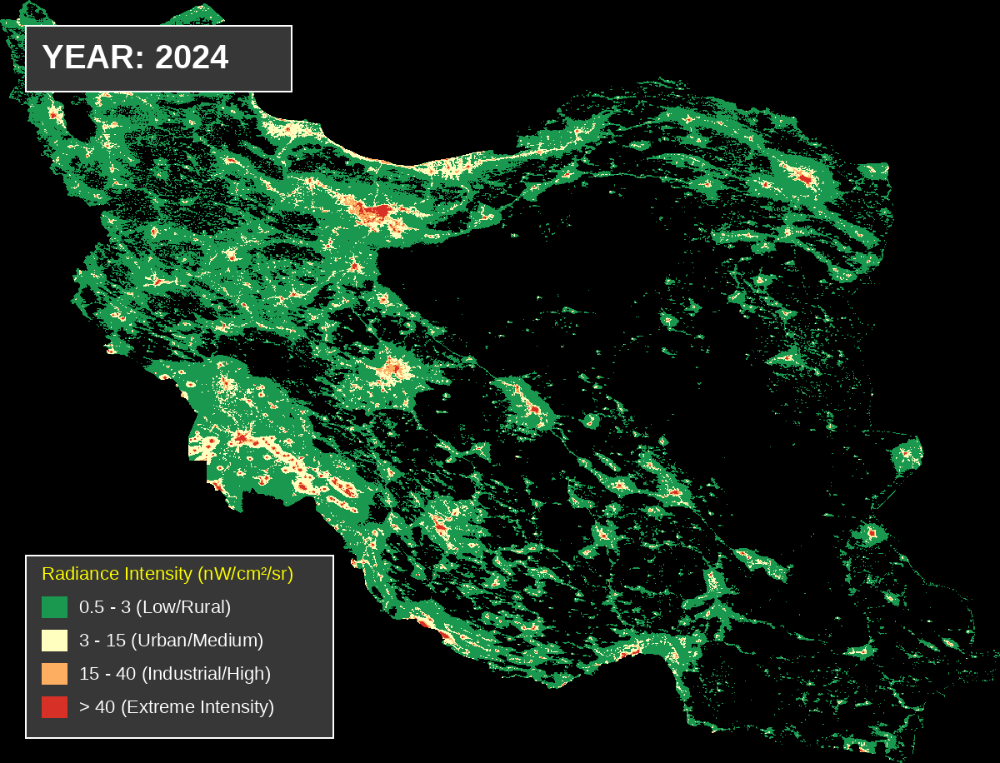
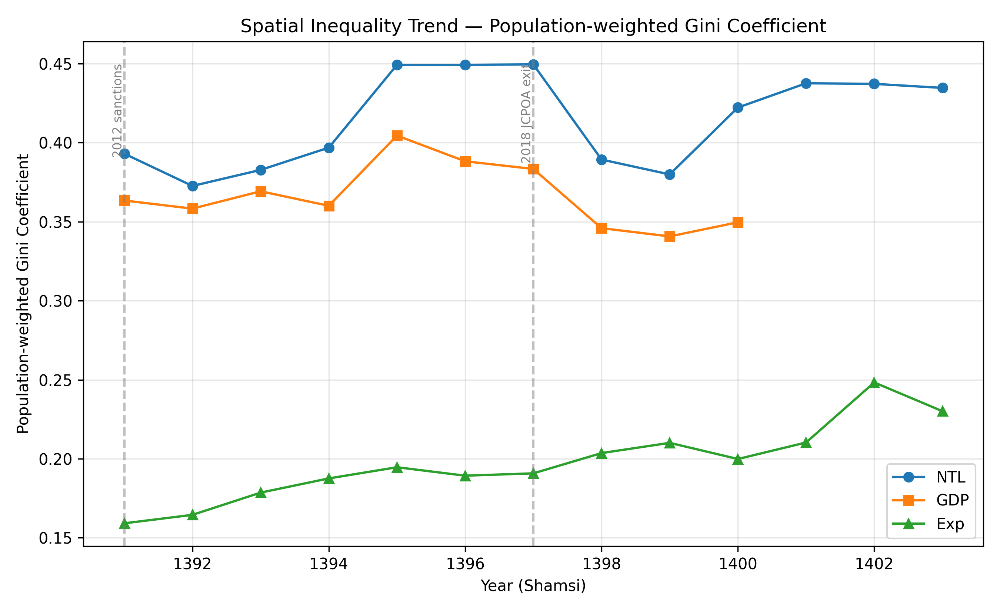

# Nighttime Lights and Regional Inequality in Iran (2012–2024)

Code and results for my thesis. It uses satellite **nighttime lights (NTL)** to measure economic
activity across Iran's 31 provinces, then tracks how **regional inequality** changed between 2012 and 2024.

<p align="center">
  
</p>

## Research overview

1. **Building the NTL panel.** Monthly radiance (nW/cm²/sr) is aggregated to provinces and converted
   to quarterly and annual series, including NTL per capita, aligned with the Iranian (Shamsi) calendar.
2. **Validating NTL as an economic proxy.**
   - *National:* co-movement of quarterly NTL with total and non-oil GDP.
   - *Provincial:* pooled and fixed-effects regressions of GDP on NTL, Spearman rank correlations,
     growth and rank concordance, and a comparison with real household expenditure per capita (HIES).
3. **Measuring regional inequality.** Population-weighted Gini, Theil, mean log deviation (MLD),
   GE(−1) and the coefficient of variation are computed for NTL, GDP and expenditure. Each index is
   computed with and without gas-flare areas, and tested for a structural break around 2018
   (U.S. withdrawal from the JCPOA).

<p align="center">
  
  
</p>

## Repository structure

```
.
├── data/                  # Inputs (only shapefile and small files tracked; see data/README.md)
│   └── shapefile/         # Provincial boundaries of Iran
├── src/
│   ├── data_prep/         # Scripts that build the NTL, population and GDP panels
│   └── figures/           # Scripts for provincial bar charts and maps
├── notebooks/             # Validation and inequality analysis
├── stata/                 # Regression do-file (GDP on NTL)
├── output/                # Figures, tables and regression results
│   ├── Iran_NTL-overview/
│   ├── Province_NTL_1.5km2012vs2024/
│   ├── Province_NTL_10km_2012vs2024/
│   ├── Province_Diff_NTL/
│   ├── Province_NTL_graph/
│   ├── Validation/
│   ├── Inequality/
│   └── StructuralBreak_full_output.txt
└── requirements.txt
```

## Reproducing the analysis

```bash
git clone <this-repo-url>
cd <repo>
python -m venv .venv && source .venv/bin/activate   # Windows: .venv\Scripts\activate
pip install -r requirements.txt
```

Put the input data in `data/` as described in [`data/README.md`](data/README.md). All paths are
resolved relative to the repository root, so scripts and notebooks can be run from any directory.

### 1. Data preparation (`src/data_prep/`)

| Order | Script | Output |
|---|---|---|
| 1 | `ntl_monthly_add_shamsi.py` | Monthly NTL with Shamsi dates |
| 2 | `ntl_quarterly.py` | National quarterly NTL |
| 3 | `population_1390_1395.py` | Provincial census population, 1390–1395 |
| 4 | `population_1390_1404.py` | Provincial population, interpolated and extrapolated to 1404 |
| 5 | `ntl_per_capita_annual.py` | Annual provincial NTL per capita |
| 6 | `province_gdp_panel.py` | Provincial GDP panel |
| 7 | `province_gdp_per_capita.py` | Provincial GDP per capita, 1390–1400 |
| 8 | `national_gdp_per_capita.py`, `national_gdp_per_capita_quarterly.py` | National GDP per capita |

`province_gdp_master_corrected.py` is an alternative version of step 7 with extra province-name corrections.

### 2. Analysis (`notebooks/`)

| Notebook | Content |
|---|---|
| `ntl_gdp_validation.ipynb` | National and provincial validation of NTL against GDP; exports the Stata datasets |
| `hies_gdp_ntl_master.ipynb` | Merges NTL, GDP and HIES expenditure into one provincial master dataset |
| `ntl_gdp_expenditure_validation.ipynb` | NTL and GDP against real household expenditure per capita |
| `growth_rank_concordance.ipynb` | Growth and rank concordance between NTL and GDP per capita |
| `inequality_indices.ipynb` | Inequality indices and structural-break tests |
| `province_ntl_graphs.ipynb` | Provincial NTL graphs |

### 3. Regressions (`stata/`)

Run `stata/ntl_gdp_validation.do` with the repository root as Stata's working directory.
It estimates pooled and fixed-effects regressions of GDP on NTL. The results are saved as `.rtf`
tables in `output/Validation/`.

## Data sources

- **Nighttime lights:** monthly satellite radiance composites, 2012–2024
- **GDP and provincial accounts, population, CPI:** Statistical Centre of Iran
- **Household expenditure:** Household Income and Expenditure Survey (HIES), accessed with [`hbsir`](https://pypi.org/project/hbsir/)
- **Boundaries:** provincial shapefile of Iran

## Author

Armin Khalilzadeh — [@arminkhalilzadeh](https://github.com/arminkhalilzadeh)
